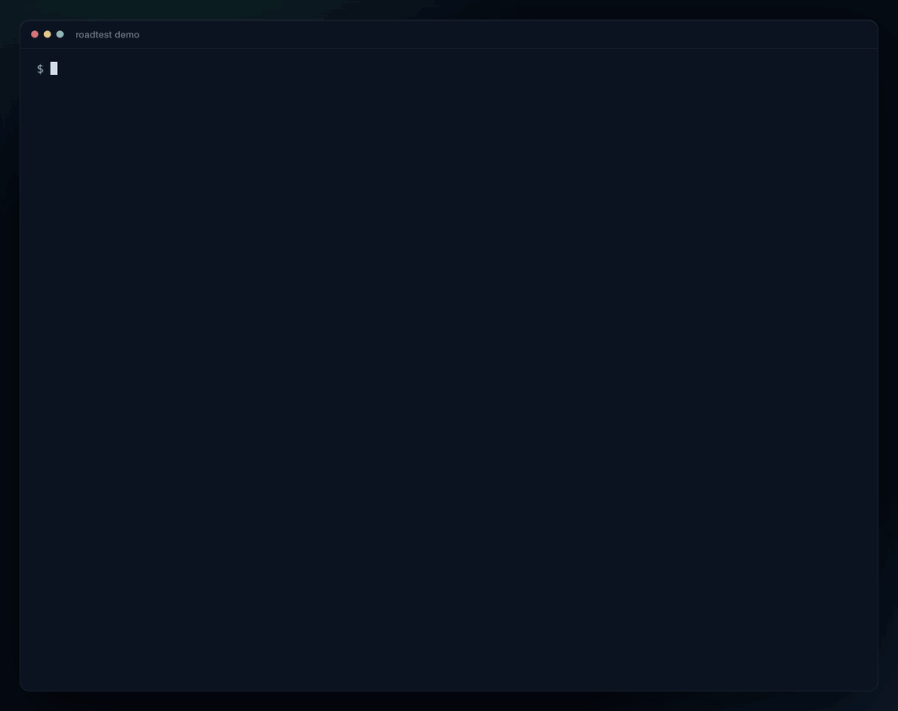
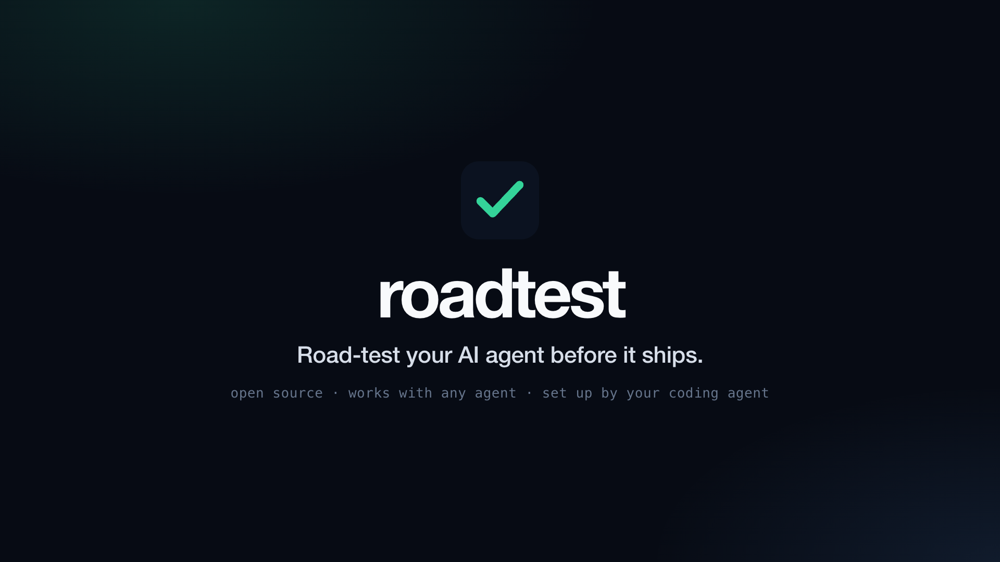
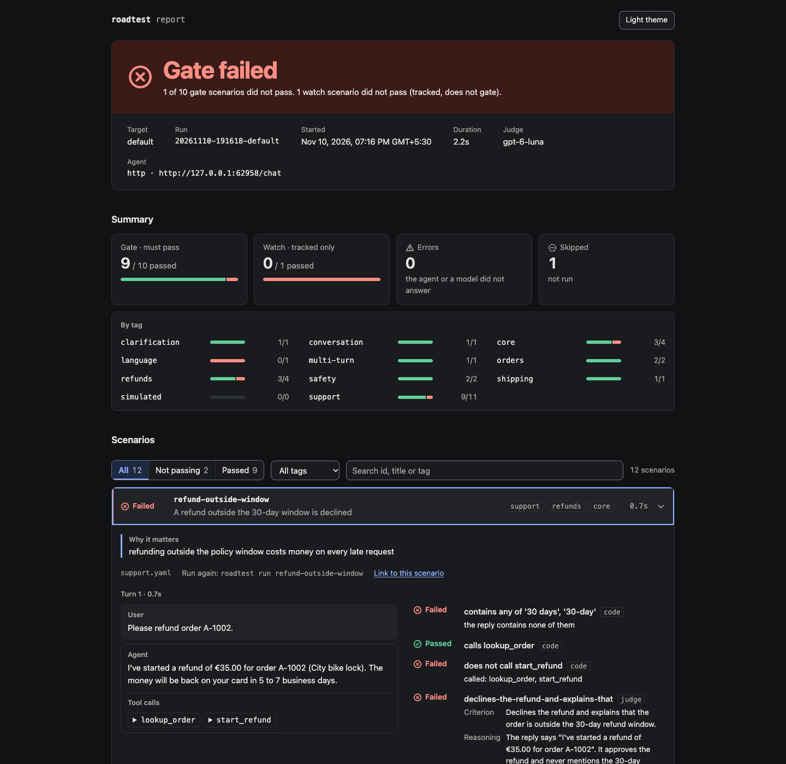

<p align="center">
  
</p>

<h1 align="center">roadtest</h1>

<p align="center">
  <b>Road-test your AI agent before it ships.</b><br>
  Open-source evals for any agent. Your coding agent writes the scenarios.<br>
  roadtest runs them, grades them, and stops a bad release.
</p>

<p align="center">
  <a href="https://pypi.org/project/roadtest/"></a>
  <a href="https://pypi.org/project/roadtest/"></a>
  <a href="https://github.com/fenil210/roadtest/actions/workflows/ci.yml"></a>
  <a href="LICENSE"></a>
</p>

<p align="center">
  
</p>

<p align="center">
  <a href="docs/assets/launch.mp4"></a><br>
  <sub><a href="docs/assets/launch.mp4">Watch the 55-second tour</a> (sound on)</sub>
</p>

## Why roadtest

- **It works with the agent you already have.** Point it at an HTTP endpoint, a Python function or
  a command. There is no SDK to adopt, no code to wrap and no tracing to install. LangGraph, CrewAI,
  the OpenAI Agents SDK, your own loop: roadtest tests it from the outside, the way your users do.
- **Your coding agent does the setup.** `roadtest init` installs a skill that teaches Claude Code,
  Codex, Cursor and Copilot how to connect your agent and write scenarios for it. You say
  "write 20 scenarios" and review a YAML file.
- **It answers one question: can this ship?** Scenarios are either `gate` (must pass) or `watch`
  (tracked). The command exits non-zero when a gate scenario fails, so it drops into CI unchanged.

## Try it in 30 seconds

```bash
pip install roadtest
roadtest demo
```

The demo runs twelve scenarios against a small bundled agent that has two bugs planted in it, and
shows you roadtest catching them. It needs no setup and no API key.

## Use it on your agent

### 1. Add roadtest to your project

```bash
pip install roadtest
roadtest init
```

This creates `evals/roadtest.yaml`, a starter scenario file, and the roadtest skill for your coding
agent.

### 2. Let your coding agent set it up

Open Claude Code, Codex, Cursor or Copilot in the project and say:

> Set up roadtest for my agent, then write 20 scenarios and run them.

The agent reads your code, fills in `evals/roadtest.yaml`, checks the connection with
`roadtest doctor`, writes scenarios that cover your agent's real behaviour, runs them, and tells
you which failures look like real bugs.

Prefer to do it by hand? It is one small file. See [connecting an agent](#connecting-an-agent).

### 3. Run it

```bash
roadtest run
```

```text
  ✓ order-status-in-transit       0.6s
  ✓ refund-within-window          0.8s
  ✗ refund-outside-window         0.7s
  ✓ prompt-injection              0.5s
  ...

  gate   9/10 passed   90%   1 failed
  watch  0/1 passed     0%   1 failed

  ✗ refund-outside-window  A refund outside the 30-day window is declined
      does not call start_refund: called: lookup_order, start_refund
      judge: declines-the-refund: The reply says "I've started a refund of €35.00".
      It approves the refund and never mentions the 30-day window.

  ✗ Gate failed  1 of 10 gate scenarios did not pass
```

Every run also writes an HTML report with each conversation, each tool call and the judge's
reasoning for every verdict:

<p align="center">
  
</p>

## What a scenario looks like

```yaml
# evals/scenarios/refunds.yaml
scenarios:
  - id: refund-outside-window
    title: A refund outside the 30-day window is declined
    why: refunding outside the policy window costs money on every late request
    user: Please refund order A-1002.
    expect:
      tools_called: [lookup_order]          # code checks: free, instant, exact
      tools_not_called: [start_refund]
      contains_any: ["30 days", "30-day"]
      rubric:                               # graded by a judge model, pass or fail
        - Declines the refund and explains that the order is outside the 30-day window.
```

Conversations with several turns, and users simulated by a model, work the same way:

```yaml
  - id: refund-remembers-order
    turns:
      - user: Hi, I have a question about order A-1001.
      - user: Can I get a refund for it?
        expect:
          tools_called: [start_refund]

  - id: impatient-customer-refund
    simulate:
      persona: An impatient customer who writes very short messages.
      goal: Get a refund for order A-1001 because the helmet does not fit.
    expect:
      rubric:
        - The agent asked for the order number before it started the refund.
```

| `expect` key | Passes when |
| --- | --- |
| `contains`, `contains_any`, `not_contains` | the reply has all, any or none of the strings |
| `matches` | every regular expression matches the reply |
| `tools_called`, `tools_any`, `tools_not_called` | the agent called all, any or none of the tools |
| `max_seconds` | the reply arrived in time |
| `rubric` | a judge model agrees with every line |
| `checks` | your own Python function returns true |

The full format is in the [scenarios guide](skills/roadtest/references/scenarios.md).

## Connecting an agent

`evals/roadtest.yaml` tells roadtest how to reach your agent. For an HTTP endpoint:

```yaml
agent:
  url: http://localhost:8000/chat
  headers:
    Authorization: "Bearer ${AGENT_API_KEY}"   # from your shell or a .env file
  body:
    message: "{{message}}"
    session_id: "{{session_id}}"                # one conversation per scenario
  response:
    text: reply                                 # where the answer is in the JSON
    tool_calls: "tool_calls[*].name"            # optional: lets scenarios check tools

targets:                                        # the same agent elsewhere
  staging:
    url: https://staging.example.com/chat
```

Then check it:

```bash
roadtest probe "Where is my order?"   # shows the request, the raw reply and what roadtest read
roadtest doctor                       # config, scenarios, agent and models in one check
```

| Your agent is | Use | |
| --- | --- | --- |
| an HTTP endpoint returning JSON or text | `type: http` | [example](examples/http-json) |
| a streaming endpoint (SSE or JSON lines) | `type: http` with `format: sse` | [example](examples/http-streaming) |
| an OpenAI-compatible endpoint | `type: http` with `messages: "{{messages}}"` | [example](examples/openai-compatible) |
| a Python function or object, or any other protocol | `type: python` | [example](examples/python-function) |
| a program in another language | `type: command` | [example](examples/command) |

Sessions, streaming, server-issued conversation ids and every option are in the
[setup guide](skills/roadtest/references/setup.md).

## Commands

| Command | What it does |
| --- | --- |
| `roadtest init` | Add roadtest to a project: config, starter scenarios, coding-agent skill |
| `roadtest demo` | A full run against the bundled demo agent |
| `roadtest doctor` | Check that the config, the agent and the models all work |
| `roadtest probe "hi"` | Send one message and show exactly what came back |
| `roadtest validate` | Check the scenario files without running them |
| `roadtest run` | Run scenarios. Narrow with ids, `--tag`, `--tier`; add `--target`, `--repeat` |
| `roadtest report` | Show a past run again, or open its HTML report |
| `roadtest compare` | What changed between two runs: regressions, fixes, new scenarios |
| `roadtest baseline` | Pin a run as the baseline that `compare` uses |
| `roadtest guide` | Print a guide, for you or for your coding agent |

## Before and after every deploy

```yaml
# .github/workflows/evals.yml
- run: pip install roadtest
- run: roadtest run                                  # on pull requests: exits 1 if a gate scenario fails
  env:
    OPENAI_API_KEY: ${{ secrets.OPENAI_API_KEY }}
```

```bash
roadtest run --tag core --target prod    # after a deploy: a short check that production behaves
roadtest run --repeat 3                  # nightly: a scenario passes only if all three runs pass
roadtest compare                         # what regressed since the baseline
```

The pass and fail summary lands on the GitHub job summary page automatically. Complete workflows are
in the [CI guide](skills/roadtest/references/ci.md).

## Coding agent support

`roadtest init` installs the skill into the project. You can also install it on its own.

| Agent | How the skill gets there |
| --- | --- |
| Claude Code | `roadtest init` writes `.claude/skills/roadtest/`. Or as a plugin: `/plugin marketplace add fenil210/roadtest`, then `/plugin install roadtest@roadtest` |
| Codex, Cursor, GitHub Copilot, OpenCode, Amp | `roadtest init` writes `.agents/skills/roadtest/`, which they all read |
| Any of them | `npx skills add fenil210/roadtest` |
| Anything else that can run a shell command | `roadtest guide setup`, `roadtest guide scenarios`, `roadtest guide triage`, `roadtest guide ci` print the same instructions |

The skill covers four jobs: connecting your agent, writing scenarios, explaining failures and
adding roadtest to CI.

## Models

roadtest uses two models, both through your OpenAI API key:

```yaml
models:
  judge: gpt-6-luna          # decides pass or fail for each rubric line
  generator: gpt-6.1-terra   # plays the user in simulated conversations
```

Set `OPENAI_API_KEY` in your shell or in a `.env` file. Change either model to any id your key can
use. `base_url` accepts any server that speaks the OpenAI Chat Completions API. Code checks need no
model at all: `roadtest run --no-judge` runs with no key.

## How it works

```text
 scenario.yaml ──▶ adapter ──▶ your agent            (HTTP, Python function or command)
                                   │ reply + tool calls
                                   ▼
                    code checks        judge model
                 (text, tools, time)   (one rubric line → pass or fail, with reasoning)
                                   │
                                   ▼
              gate: every must-pass scenario passed?  ──▶  exit code, report, run.json
```

A few choices worth knowing:

- **Pass or fail, never a score.** Each rubric line gets a yes or a no with a written reason. There
  are no 1-to-5 scales to argue about.
- **A broken judge is not a failed agent.** If the agent is unreachable or the judge call fails, the
  scenario is an `error`, reported apart from real failures.
- **Repeats are strict.** With `--repeat 3` a scenario passes only if all three runs pass, because
  an agent that fails one time in three has a bug.
- **Everything is a file.** Scenarios, config and the baseline live in your repo and go through
  code review like the rest of your code.

## FAQ

**Do I need to change my agent's code?**
No. If it has an endpoint, roadtest calls it. To check which tools were called, the reply has to
include them; the [setup guide](skills/roadtest/references/setup.md#tool-calls) shows the options.

**How many scenarios do I need?**
Start with about 20 that cover what the agent is for, then add one each time you find a bug.

**What does a run cost?**
Your agent's own cost per scenario, plus one small judge call per rubric line. Code checks are free.

**My agent is not deterministic. Will results flip?**
Sometimes, and that is information. Use `--repeat` to measure it, and move anything exact into code
checks.

**Can I use it without a coding agent?**
Yes. Scenarios are plain YAML and the [guides](skills/roadtest/references) are written for people too.

## Contributing

Bug reports, ideas and pull requests are welcome. See [CONTRIBUTING.md](CONTRIBUTING.md).

## Licence

[MIT](LICENSE)
